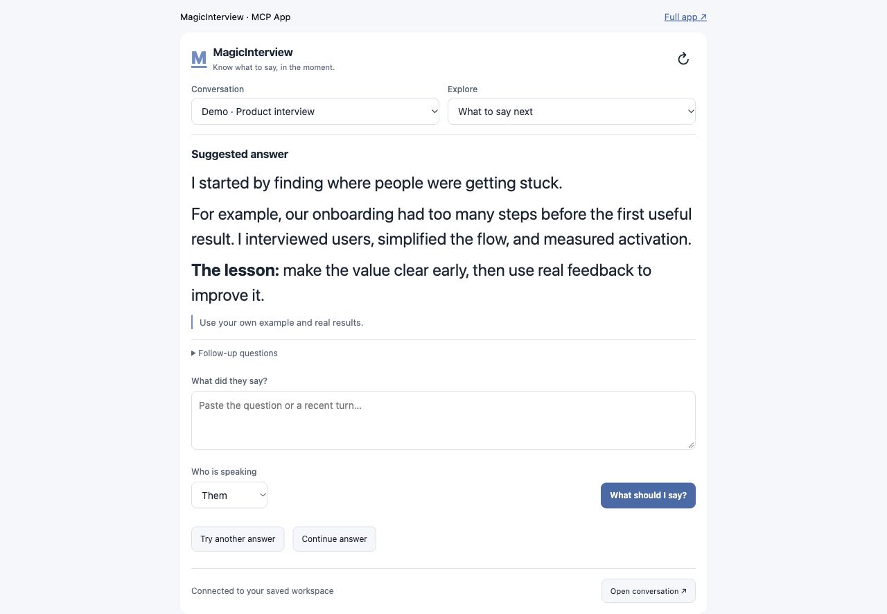
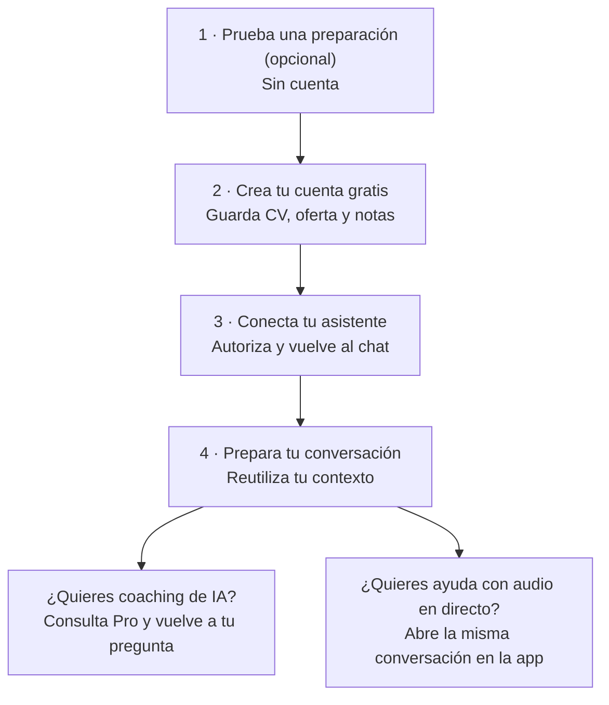

# MagicInterview — know what to say next, live


MagicInterview helps you know what to say next in interviews and meetings. In the full MagicInterview app, start live listening to receive suggested responses as the conversation happens. Through the connected AI workspace, add your CV, job description, client brief and notes, then get context-grounded answers and prepare the conversation.



*Espacio del asistente · contenido ficticio de demostración. El audio en directo se abre en la app completa. / Assistant workspace · fictional demo content. Live audio opens in the full app.*

## Empieza aquí · Start here

**¿Es tu primera vez?** MagicInterview te ayuda a saber qué decir en una entrevista o reunión. Puedes probar una preparación antes de crear una cuenta. La cuenta, la conexión con tu asistente y el espacio donde guardas tu CV, ofertas y notas son gratuitos. El coaching en la nube y las herramientas de IA requieren Pro.



| Tu siguiente paso | Qué hacer | Qué obtienes |
| --- | --- | --- |
| **1. Pruébalo (opcional)** | [Prueba gratuita sin cuenta](https://magicinterview.ai/interview-tomorrow) | Una muestra de preparación antes de registrarte. |
| **2. Guarda tu contexto** | [Crea una cuenta gratis](https://magicinterview.ai/app?auth=sign-up) | Un espacio propio para CV, ofertas, notas y conversaciones. Sin tarjeta. |
| **3. Conecta tu asistente** | Instala este plugin o añade el servidor; pulsa conectar e inicia sesión en el navegador. | Autoriza el acceso a tu cuenta y vuelve al mismo asistente. Los clientes compatibles usan OAuth, sin copiar tokens. |
| **4. Prepara y continúa** | Pide: «Es mi primera vez. Ayúdame a preparar una entrevista con mi CV y la oferta, sin solicitar coaching de IA todavía». | Tu conversación y su contexto guardados. Cuando quieras coaching, [consulta Pro](https://magicinterview.ai/app?auth=sign-up&returnTo=pro) y vuelve a tu pregunta. |

**Para escuchar una llamada:** abre la conversación en la app de MagicInterview y activa la escucha allí. El plugin usa texto y contexto guardado; no captura el audio de tu reunión desde el chat. [Cómo funciona](https://magicinterview.ai/how-it-works).

**New to MagicInterview?** You can [try a preparation preview without an account](https://magicinterview.ai/interview-tomorrow), then [create a free account](https://magicinterview.ai/app?auth=sign-up) to save your CV, job details and notes. Install this plugin, connect through your assistant's browser sign-in, approve access and return to the assistant. Ask it to prepare your first conversation using that context. Your account, connection and saved workspace are free; cloud coaching and AI tools require [Pro](https://magicinterview.ai/app?auth=sign-up&returnTo=pro). No card is required for a free account. Open the same conversation in the full app for live audio capture.

## Live help when the conversation matters

**Interviewing for your next job?** Add your CV and the job description. Get live suggestions that connect your experience to the role when the interviewer asks a question.

**Finally meeting that potential client?** Bring your client brief, offer, and past notes. Get help answering questions, responding to objections, and explaining the value of your offer as the call unfolds.

**Keep your next answer in view.** Open MagicInterview on your phone beside your computer, or use it on the same computer as your call. Start listening in MagicInterview and follow the suggestions as the conversation happens.


## What the plugin connects

This plugin connects your AI assistant to your MagicInterview workspace so it can:

- Find, create, and update projects and conversations, then open the exact meeting in MagicInterview.
- Add relevant CVs, job descriptions, client briefs, and documents to your conversations.
- Keep shared project sources consistent across related meetings while preserving individual notes and history.
- Help set up today's professional meetings in time order. When your assistant has calendar or CRM access, it can use that context too.
- Request coaching and review saved guidance for a conversation.

Your assistant sets up the context and opens the right conversation. Start listening in the MagicInterview app when you are ready for live suggestions.


**Notion notes and meeting sync:** Connect Notion from Workspace → Notion on the web to import shared pages as reusable sources, or enable optional meeting sync. With meeting sync enabled, keep your brief in Notion and bring transcripts and saved coaching back to your notes. [Set up Notion](https://magicinterview.ai/guides/connect-notion). Setup and sync management use the web app; saved sources stay available across signed-in devices.

## A compact workspace inside your assistant

In compatible MCP App hosts, ask to open MagicInterview. The interactive workspace uses your connected account's real projects, conversations, sources, preferences, and saved history—not a separate copy.

One compact feature menu covers:

- **What to say next and coding help:** submit a question, get a context-aware answer, and read formatted prose or code.
- **Transcript & speakers:** inspect saved turns, add transcript text, and correct speaker labels.
- **Context & files and projects & conversations:** preview Markdown and original files, attach relevant sources, and manage shared project context and individual conversation notes.
- **Research & CRM and recap & follow-up:** ask your assistant to use its connected services and current sources, refresh relevant context, or draft a recap and follow-up without sending it.
- **Languages & models and account settings:** manage preferences and inspect connection status.
- **Audio/text/screenshots, focus/reading, and voice practice:** paste text in the workspace or open the same conversation in the full app for device-based audio, screenshots, focus controls, and voice practice.

Live listening does not start remotely through MCP. Use the web app on your computer or phone, or the Mac and Android apps. On iPhone, add MagicInterview to your Home Screen for quick access. Links preserve the selected conversation.

## Connect through your assistant

Install the plugin and choose **Connect** in your AI assistant. When the browser opens, create a free MagicInterview account or sign in, approve the connection, and return to your assistant. OAuth-capable clients handle authorization without copying an API key. If your client only supports a bearer token, use the optional manual setup in [connection settings](https://magicinterview.ai/app/settings/mcp); keep that token private.

### Technical MCP endpoint

For clients configured manually, the remote Streamable HTTP endpoint is:

```text
https://magicinterview.ai/mcp
```

For the public ChatGPT directory, use `https://magicinterview.ai/mcp?toolset=directory` to expose each supported operation directly. The default endpoint uses a compact operation catalog for other clients.

## Suggested prompts

- I am new to MagicInterview. Help me save my CV and job details and prepare my first conversation before requesting AI coaching.

- Help me answer this interview question now. Use my CV and job description to suggest a clear response I can say aloud.
- A client just raised an objection. Use my meeting brief to suggest what to say next and one useful follow-up question.
- Open my MagicInterview workspace and prepare my next meeting with a concise brief and context for live answers.

## If you get stuck

| What you see | What to do next |
| --- | --- |
| No account or a sign-in request | Create a free account in the connection window, approve access and return to your assistant. An installed plugin still needs an authorized connection. |
| An empty workspace | Ask your assistant to create your first conversation using the CV, job details or brief you supply. No prior projects are required. |
| “Pro required” | Follow the upgrade link returned by MagicInterview if you want cloud coaching. Keep the question and retry after upgrading; workspace preparation remains free. |
| A pending payment | Check the order status in Settings. Opening or returning from checkout does not confirm payment or Pro access. |
| A connection or conversation error | Ask your assistant to check the affected conversation and relevant saved debug information. Never paste tokens or passwords into the chat. |

## Links

- [MagicInterview](https://magicinterview.ai)
- [Privacy policy](https://magicinterview.ai/privacy)
- [Terms of service](https://magicinterview.ai/terms)
- [Support](https://magicinterview.ai/contact)

## License

MIT
